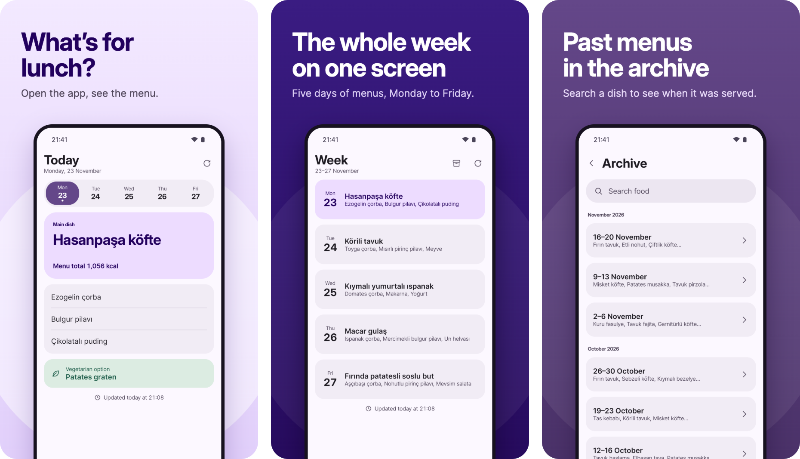
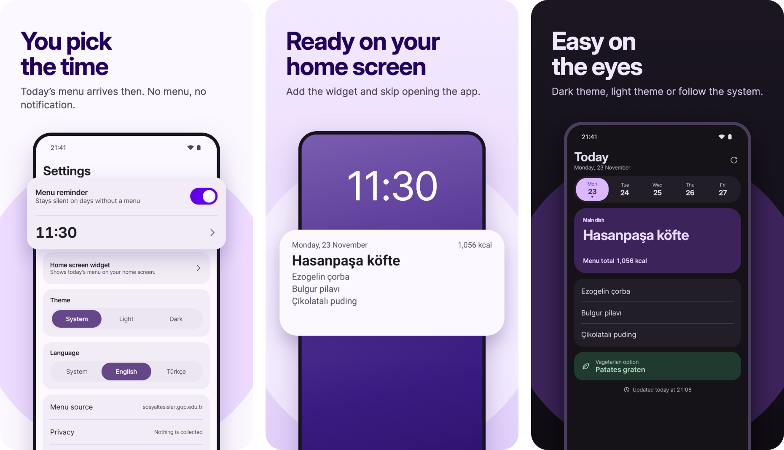

# TOGÜ Yemekhane

An Android app that shows the weekly cafeteria menu of Tokat Gaziosmanpaşa University. Version 4 is rewritten from scratch in Kotlin and Jetpack Compose.

[](https://play.google.com/store/apps/details?id=com.mercan.app)

> **Unofficial.** This is a personal project. It is not affiliated with, endorsed by or operated by the university. The menu comes from the university's [public menu page](https://sosyaltesisler.gop.edu.tr/yemekhane_menu.aspx); the page itself is always the authority.

## How the menu data works

There is no server and no user account. A small Kotlin program runs on a schedule in GitHub Actions, reads the menu page and publishes it as static JSON. The app downloads that JSON and keeps it on the device.

## Features

- Today's menu: the main dish, the other dishes, the vegetarian option and calories
- The whole week; a day opens in Today
- Archive of finished weeks, with a search that shows when a dish was served
- Local menu reminder that stays silent on days without a menu
- Home screen widget
- Works offline once downloaded
- English and Turkish, light and dark theme

A failed download never erases the menu on the device. No account, ads or analytics; see the [privacy policy](https://cusufcan.github.io/yemekhane/privacy.html).

## Screenshots




## How it is built

One module with `data`, `domain`, `ui` and `platform` packages. Room is the single source the screens read from; the network only writes into it. ViewModels expose one `StateFlow` per screen. Hilt wires the parts, Navigation Compose uses typed routes, and background work is plain `JobScheduler` and `AlarmManager`.

## Stack

- Kotlin, Jetpack Compose (Material 3)
- MVVM with unidirectional data flow
- Room + Kotlin Flow, DataStore
- Hilt (KSP), Navigation Compose with type-safe routes
- Kotlin menu robot, GitHub Actions and GitHub Pages
- JUnit, coroutines-test, GitHub Actions CI

## Build

Requirements: JDK 17 and the Android SDK (min SDK 25, target SDK 37).

```bash
./gradlew assembleDebug  # debug APK
./gradlew test           # unit tests
./gradlew lintDebug      # lint
./gradlew -p robot test  # menu robot tests
```

## Credits

Built in collaboration with AI coding agents such as Claude and Codex.

## License

Copyright © 2026 Yusuf Can Mercan. All rights reserved.

The source code is published for viewing only. Copying, modifying, redistributing or using it for commercial purposes requires written permission. See [LICENSE](LICENSE).

## Contact

- LinkedIn: [linkedin.com/in/cusufcan](https://linkedin.com/in/cusufcan)
- Email: [yusufcanmercan.info@gmail.com](mailto:yusufcanmercan.info@gmail.com)
